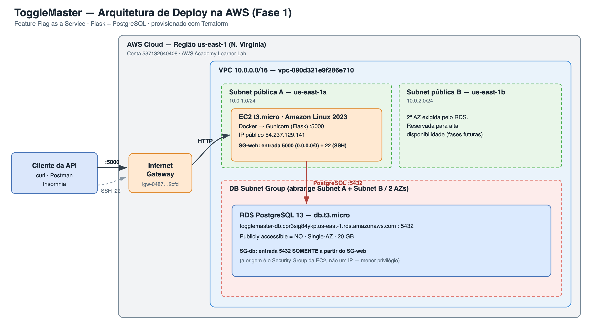
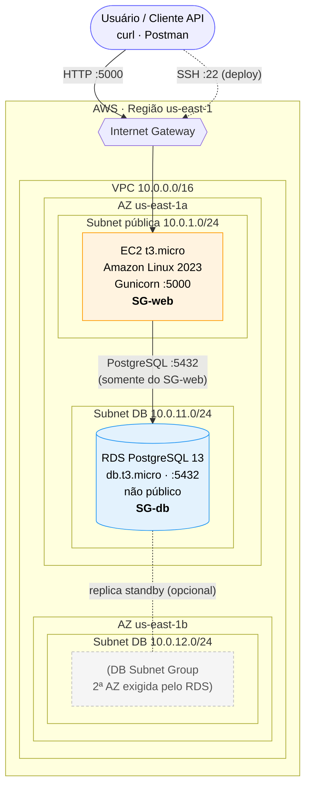

# Arquitetura na Nuvem — ToggleMaster (Fase 1)

Este documento descreve a arquitetura de implantação do **ToggleMaster** na AWS, as
decisões de projeto e a estimativa de custos. O objetivo da Fase 1 é implantar o MVP
(uma API monolítica em Flask + PostgreSQL) de forma segura e controlada.

## 1. Visão geral

A aplicação é um **monólito**: um único artefato (a API Flask servida por Gunicorn)
que concentra toda a lógica. Ele depende de um banco de dados **PostgreSQL** para
persistir as *feature flags*.

Na nuvem, separamos essas duas responsabilidades em dois serviços gerenciados:

| Camada | Serviço AWS | Papel |
| :----- | :---------- | :---- |
| Computação | **EC2** (t3.micro) | Roda o container/aplicação (Gunicorn na porta 5000) |
| Banco de dados | **RDS PostgreSQL** (db.t3.micro) | Persistência gerenciada das flags |
| Rede | **VPC** dedicada (10.0.0.0/16) | Isolamento de rede |
| Segurança | **Security Groups** | Firewall stateful entre internet ⇄ EC2 ⇄ RDS |

## 2. Diagrama

> Versão renderizada (PNG). Abaixo, a mesma arquitetura como código (Mermaid), e o fonte
> editável em [docs/arquitetura.drawio](docs/arquitetura.drawio).

> O diagrama acima é renderizado automaticamente pelo GitHub. Para a entrega do vídeo,
> exporte uma versão em [draw.io](https://app.diagrams.net/) ou [Miro](https://miro.com/)
> e coloque o link no `ENTREGA.md`.

## 3. Fluxo de rede e segurança

O controle de acesso é feito por **Security Groups** (firewall *stateful* a nível de
recurso). Aplicamos o princípio do **menor privilégio**:

### SG-web (anexado à EC2)
| Direção | Porta | Protocolo | Origem/Destino | Justificativa |
| :------ | :---- | :-------- | :------------- | :------------ |
| Entrada | 5000 | TCP | `0.0.0.0/0` | Acesso público à API |
| Entrada | 22 | TCP | **Seu IP** (`x.x.x.x/32`) | SSH restrito para o deploy |
| Saída | Todas | Todos | `0.0.0.0/0` | Baixar pacotes, falar com o RDS |

### SG-db (anexado ao RDS)
| Direção | Porta | Protocolo | Origem | Justificativa |
| :------ | :---- | :-------- | :----- | :------------ |
| Entrada | 5432 | TCP | **SG-web** (não um IP/CIDR) | Só a EC2 acessa o banco |
| Saída | Todas | Todos | `0.0.0.0/0` | Padrão |

> **Decisão de segurança chave:** a entrada 5432 do RDS referencia o **Security Group da
> EC2**, não um bloco de IP. Assim, mesmo que o IP da EC2 mude, a regra continua válida, e
> nenhum host fora da VPC consegue alcançar o banco. O RDS é criado com
> `publicly_accessible = false`.

## 4. Decisões de arquitetura e trade-offs

- **Monólito vs. microsserviços:** para o MVP, o monólito é a escolha certa — deploy
  simples, menos peças móveis, latência interna zero. A desvantagem (escala acoplada, um
  ponto de falha) é aceitável nesta fase e será endereçada em fases futuras.
- **RDS vs. Postgres na própria EC2:** escolhemos **RDS** (gerenciado) por backups
  automáticos, patching e a possibilidade de Multi-AZ. Custa um pouco mais que instalar o
  Postgres na EC2, mas remove trabalho operacional — cultura DevOps.
- **EC2 vs. containers gerenciados (ECS/Fargate):** mantivemos **EC2** por ser o escopo da
  Fase 1 (provisionamento manual e entendimento de infraestrutura básica). ECS/Fargate/EKS
  ficam para fases posteriores.
- **VPC dedicada vs. default:** criamos uma **VPC própria** para exercitar o desenho de
  rede (subnets pública/privada, IGW, route tables) — mais didático e mais seguro.
- **Duas subnets para o RDS:** o RDS exige um *DB Subnet Group* com pelo menos **2 AZs**,
  mesmo em modo Single-AZ. Por isso há subnets em `us-east-1a` e `us-east-1b`.

## 5. Estimativa de custos

Valores de referência para **us-east-1** (podem variar). Para o desafio, use **AWS Academy**
ou **Free Tier**, onde o custo tende a **US$ 0** dentro dos limites.

| Recurso | Especificação | Free Tier (12 meses) | Custo fora do Free Tier (aprox.) |
| :------ | :------------ | :------------------- | :------------------------------- |
| EC2 | t3.micro, 1 instância | 750 h/mês grátis | ~US$ 7,50/mês (on-demand) |
| RDS | db.t3.micro, Single-AZ, 20 GB gp2 | 750 h/mês + 20 GB grátis | ~US$ 12–15/mês |
| EBS (EC2) | 8 GB gp3 | incluso nos 30 GB grátis | ~US$ 0,64/mês |
| Tráfego de saída | < 1 GB/mês | 100 GB grátis | ~US$ 0,09/GB |
| Elastic IP | 1, associado | grátis enquanto associado | ~US$ 3,60/mês se ocioso |
| **Total estimado** | | **~US$ 0 (Free Tier/Academy)** | **~US$ 20–27/mês** |

> **💸 Atenção a custos:** desligue/derrube os recursos após a avaliação
> (`terraform destroy` ou removendo manualmente). Um Elastic IP **não associado** e um RDS
> ligado são as principais fontes de cobrança silenciosa.

## 6. Como esta arquitetura evolui (fases futuras)

- Alta disponibilidade: **RDS Multi-AZ** + **Auto Scaling Group** atrás de um **ALB**.
- Empacotamento: publicar a imagem no **ECR** e migrar para **ECS/Fargate**.
- Observabilidade: **CloudWatch** (logs/métricas/alarmes).
- Segredos: **AWS Secrets Manager** / **SSM Parameter Store** no lugar de variáveis de ambiente.
